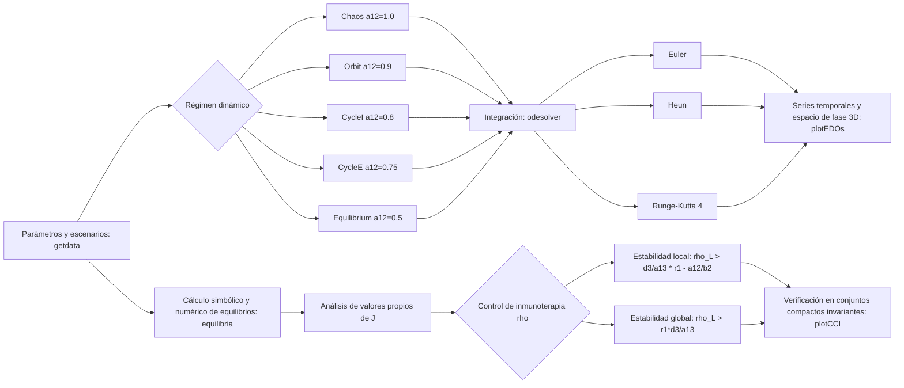

[](https://matlab.mathworks.com/open/github/v1?repo=Jose-VenTor/MMP2)

# Práctica 2 — Caos en sistemas biológicos

Repositorio académico de la asignatura **Modelado Matemático / Gemelos Digitales**, correspondiente a la **Maestría en Ciencias de la Ingeniería** del Tecnológico Nacional de México / Instituto Tecnológico de Tijuana. La práctica integra modelado matemático de sistemas biológicos no lineales de tercer orden, análisis cualitativo de estabilidad local y global, localización de conjuntos compactos invariantes, comparación de métodos numéricos de diferencias finitas y simulación computacional en MATLAB.

El caso de estudio utiliza un modelo tridimensional de cáncer basado en Itik y Banks (2010) para analizar la interacción dinámica entre tres poblaciones celulares: células anormales o patológicas ($x$), células normales o sanas ($y$) y células efectoras citotóxicas o NK ($z$), bajo el efecto de un tratamiento de inmunoterapia $\rho_i(t)$.

**Autor:** Jose Venegas Torres (`M26210088`) — `M26210088@tectijuana.edu.mx`  
**Docente:** Dr. Paul Antonio Valle Trujillo — `paul.valle@tectijuana.edu.mx`  
**Departamento:** Ingeniería Eléctrica y Electrónica (Ingeniería Biomédica)  
**Institución:** Tecnológico Nacional de México / Instituto Tecnológico de Tijuana  
**Programa:** Maestría en Ciencias de la Ingeniería

---

<a id="contenido"></a>
## Contenido

1. [Resumen](#resumen)
2. [Objetivos](#objetivos)
3. [Modelo matemático y parámetros](#modelo)
4. [Escenarios dinámicos y bifurcación](#escenarios)
5. [Análisis matemático](#analisis)
6. [Métodos numéricos de diferencias finitas](#metodos)
7. [Flujo de trabajo computacional](#flujo)
8. [Actividades y secciones del cuaderno MATLAB](#actividades)
9. [Funciones auxiliares](#funciones)
10. [Estructura del repositorio](#estructura)
11. [Requisitos y reproducibilidad](#requisitos)
12. [Referencias](#referencias)

---

<a id="resumen"></a>
## Resumen

Esta práctica estudia la dinámica no lineal y el comportamiento caótico de un sistema biológico tridimensional compuesto por células patológicas, células sanas y células efectoras del sistema inmune. A través de herramientas de análisis de sistemas dinámicos, se demuestra la positividad e invariancia de las trayectorias en el octante no negativo $\mathbb{R}_{+,0}^{3}$, se calculan los seis puntos de equilibrio del sistema de forma simbólica y numérica, y se evalúa su estabilidad local mediante la matriz Jacobiana.

Posteriormente, se delimitan los conjuntos compactos invariantes mediante derivadas de Lie y se establecen condiciones suficientes sobre el parámetro de control de inmunoterapia $\rho_i$ mediante el método directo de Lyapunov para garantizar la erradicación global de las células patológicas. Finalmente, se implementan y comparan los métodos numéricos de **Euler**, **Heun** y **Runge–Kutta de cuarto orden** en MATLAB para simular los distintos regímenes dinámicos (caos, órbita periódica, ciclos límite y equilibrio).

**Palabras clave:** atractor caótico; caos en sistemas biológicos; conjuntos compactos invariantes; diferencias finitas; estabilidad de Lyapunov; MATLAB; modelo matemático; sistemas dinámicos no lineales.

[Volver al contenido](#contenido)

---

<a id="objetivos"></a>
## Objetivos

### Objetivo general

Comparar métodos numéricos de diferencias finitas y aplicar herramientas de análisis cualitativo de sistemas dinámicos no lineales para estudiar los diferentes conjuntos compactos invariantes, bifurcaciones, condiciones de estabilidad local y erradicación global de células patológicas en un sistema biológico de tercer orden.

### Objetivos específicos

- Formular el sistema de tres ecuaciones diferenciales ordinarias (EDOs) no lineales que describe la interacción celular.
- Demostrar la positividad e invariancia del sistema en el octante no negativo $\mathbb{R}_{+,0}^{3}$.
- Calcular los puntos de equilibrio simbólicos y numéricos, incluyendo los equilibrios libres de células patológicas ($x^* = 0$).
- Evaluar la estabilidad asintótica local mediante los valores propios de la matriz Jacobiana.
- Delimitar las cotas inferiores y superiores de las variables de estado utilizando funciones localizadoras y derivadas de Lie.
- Establecer las condiciones de eliminación local y global de células patológicas mediante el método directo de Lyapunov.
- Implementar en MATLAB los métodos de Euler, Heun y Runge–Kutta de cuarto orden para simular y comparar los cinco regímenes dinámicos del sistema.

[Volver al contenido](#contenido)

---

<a id="modelo"></a>
## Modelo matemático y parámetros

El sistema dinámico que describe la interacción entre las tres poblaciones celulares está formulado por tres EDOs no lineales de primer orden:

$$
\begin{aligned}
\dot{x} &= r_1 x(1 - b_1 x) - a_{12} xy - a_{13} xz, \\
\dot{y} &= r_2 y(1 - b_2 y) - a_{21} xy, \\
\dot{z} &= (r_3 - a_{31}) xz - d_3 z + \rho_i(t),
\end{aligned}
$$

con condiciones iniciales no negativas $x(0), y(0), z(0) \geq 0$ y parámetro de control $\rho_i(t) \geq 0$.

### Variables de estado y parámetros cinéticos

| Símbolo | Valor | Descripción |
|---|:---:|---|
| $x(t)$ | Variable | Población de células anormales o patológicas |
| $y(t)$ | Variable | Población de células normales o sanas |
| $z(t)$ | Variable | Población de células efectoras (citotóxicas o NK) |
| $r_1$ | $1.0$ | Tasa de crecimiento de las células patológicas |
| $b_1$ | $1.0$ | Inverso de la capacidad de carga máxima de las células patológicas |
| $a_{12}$ | $[0, 1]$ | Parámetro de bifurcación: fracción de células patológicas eliminadas por células sanas |
| $a_{13}$ | $2.5$ | Fracción de células patológicas eliminadas por células efectoras |
| $r_2$ | $0.6$ | Tasa de crecimiento de las células sanas |
| $b_2$ | $1.0$ | Inverso de la capacidad de carga máxima de las células sanas |
| $a_{21}$ | $1.5$ | Fracción de células sanas eliminadas por las células patológicas |
| $r_3$ | $3.0$ | Tasa de reclutamiento máximo de células efectoras |
| $a_{31}$ | $0.3$ | Fracción de células efectoras inactivadas por las células patológicas |
| $d_3$ | $0.4$ | Tasa de mortalidad natural de las células efectoras |
| $\rho_i(t)$ | Control | Tratamiento de inmunoterapia (infusión de células efectoras) |

[Volver al contenido](#contenido)

---

<a id="escenarios"></a>
## Escenarios dinámicos y bifurcación

En ausencia de tratamiento ($\rho_i = 0$), al variar el parámetro de bifurcación $a_{12} \in [0,1]$, el sistema exhibe cinco comportamientos dinámicos característicos configurados en la función `getdata`:

| Dinámica (`dynamics`) | $a_{12}$ | Condiciones iniciales $(x_0, y_0, z_0)$ | Intervalo $t$ | Descripción del comportamiento |
|---|:---:|:---:|:---:|---|
| `'chaos'` | $1.00$ | $(0.555,\; 0.148,\; 0.172)$ | $[0, 1000]$ | Atractor extraño / caótico |
| `'orbit'` | $0.90$ | $(0.254781,\; 0.115167,\; 0.600527)$ | $[0, 500]$ | Órbita periódica |
| `'cycleI'` | $0.80$ | $(0.200,\; 0.600,\; 0.100)$ | $[0, 500]$ | Ciclo límite interno |
| `'cycleE'` | $0.75$ | $(0.400,\; 0.200,\; 0.400)$ | $[0, 500]$ | Ciclo límite externo |
| `'equilibrium'` | $0.50$ | $(0.500,\; 0.500,\; 0.400)$ | $[0, 500]$ | Convergencia hacia punto de equilibrio |

[Volver al contenido](#contenido)

---

<a id="analisis"></a>
## Análisis matemático

### 1. Positividad e invariancia

Evaluando el campo vectorial sobre las fronteras del octante no negativo (criterio de De Leenheer y Aeyels):

$$
\left.\dot{x}\right|_{x=0} = 0, \qquad
\left.\dot{y}\right|_{y=0} = 0, \qquad
\left.\dot{z}\right|_{z=0} = \rho_i \geq 0.
$$

Por lo tanto, el dominio

$$
\mathbb{R}_{+,0}^{3} = \left\{ (x,y,z) \in \mathbb{R}^{3} \mid x \geq 0,\; y \geq 0,\; z \geq 0 \right\}
$$

es **positivamente invariante** para todo $t \geq 0$.

### 2. Puntos de equilibrio libres de células patológicas

Al imponer $x = 0$ en el sistema estacionario se obtienen dos equilibrios libres de enfermedad:

$$
E_0 = \left(0, 0, \frac{\rho}{d_3}\right), \qquad
E_1 = \left(0, \frac{1}{b_2}, \frac{\rho}{d_3}\right).
$$

*(Nota: De forma general, el sistema completo posee hasta 6 puntos de equilibrio simbólicos calculados mediante `solve` en MATLAB).*

### 3. Matriz Jacobiana y estabilidad asintótica local

La matriz Jacobiana general del sistema es:

$$
J(x,y,z) =
\begin{bmatrix}
r_1 - 2b_1 r_1 x - a_{12}y - a_{13}z & -a_{12}x & -a_{13}x \\
-a_{21}y & r_2 - 2b_2 r_2 y - a_{21}x & 0 \\
(r_3 - a_{31})z & 0 & (r_3 - a_{31})x - d_3
\end{bmatrix}.
$$

- **En $E_0 = \left(0, 0, \frac{\rho}{d_3}\right)$:** Los valores propios son $\lambda_1 = r_1 - \frac{a_{13}\rho}{d_3}$, $\lambda_2 = r_2 > 0$ y $\lambda_3 = -d_3 < 0$. Dado que $\lambda_2 > 0$, $E_0$ es **siempre inestable**.
- **En $E_1 = \left(0, \frac{1}{b_2}, \frac{\rho}{d_3}\right)$:** Los valores propios son $\lambda_1 = r_1 - \frac{a_{12}}{b_2} - \frac{a_{13}\rho}{d_3}$, $\lambda_2 = -r_2 < 0$ y $\lambda_3 = -d_3 < 0$.
  - **Eliminación local ($\lambda_1 < 0$):** Se garantiza cuando $\rho > \frac{d_3}{a_{13}}\left(r_1 - \frac{a_{12}}{b_2}\right)$.
  - **Persistencia ($\lambda_1 > 0$):** Ocurre cuando $\rho < \frac{d_3}{a_{13}}\left(r_1 - \frac{a_{12}}{b_2}\right)$.

### 4. Conjuntos compactos invariantes

Mediante funciones localizadoras $h_i$ y derivadas de Lie ($L_f h_i = \nabla h_i \cdot \mathbf{F}$), se delimita el dominio de localización del sistema en $\mathbb{R}_{+,0}^{3}$:

| Variable | Función localizadora | Conjunto $S(h_i) = \{L_f h_i = 0\}$ | Intervalo invariante $K_i$ |
|---|:---:|---|---|
| $x(t)$ | $h_1 = x$ | $\left\{x = \dfrac{1}{b_1} - \dfrac{a_{12}}{b_1 r_1}y - \dfrac{a_{13}}{b_1 r_1}z\right\} \cup \{x=0\}$ | $K_x = \left\{0 \leq x(t) \leq \dfrac{1}{b_1}\right\}$ |
| $y(t)$ | $h_2 = y$ | $\left\{y = \dfrac{1}{b_2} - \dfrac{a_{21}}{b_2 r_2}x\right\} \cup \{y=0\}$ | $K_y = \left\{0 \leq y(t) \leq \dfrac{1}{b_2}\right\}$ |
| $z(t)$ | $h_3 = z$ | $\left\{z = \dfrac{\rho}{d_3} + \dfrac{r_3 - a_{31}}{d_3}xz\right\}$ *(con $r_3 - a_{31} > 0$)* | $K_z = \left\{z(t) \geq \dfrac{\rho}{d_3}\right\}$ |

### 5. Estabilidad asintótica global (Método directo de Lyapunov)

Proponiendo la función candidata de Lyapunov $V(x) = x$ (definida positiva y radialmente desacotada respecto a $x$ en $\mathbb{R}_{+,0}^{3}$), su derivada temporal evaluada sobre $K_x \cap K_y \cap K_z$ satisface:

$$
\dot{V} = \dot{x} = \left(r_1 - b_1 r_1 x - a_{12}y - a_{13}z\right)x \leq \left(r_1 - b_1 r_1 x - a_{12}y_{\inf} - a_{13}z_{\inf}\right)x.
$$

Sustituyendo $y_{\inf} = 0$ y $z_{\inf} = \frac{\rho}{d_3}$, se garantiza que $\dot{V} \leq 0$ y la convergencia global hacia $E_1 = \left(0, \frac{1}{b_2}, \frac{\rho}{d_3}\right)$ (aplicando el principio de invariancia de LaSalle) si se cumple la **condición de eliminación global**:

$$
\rho > \frac{r_1 d_3}{a_{13}}.
$$

[Volver al contenido](#contenido)

---

<a id="metodos"></a>
## Métodos numéricos de diferencias finitas

La función personalizada `odesolver` implementa tres esquemas de integración explícita de paso fijo $h = dt$:

### 1. Método de Euler explícito

$$
\mathbf{X}_{n+1} = \mathbf{X}_n + dt\,\mathbf{F}(\mathbf{X}_n, \rho_n)
$$

### 2. Método de Heun (Euler mejorado)

$$
\begin{aligned}
\widetilde{\mathbf{X}}_{n+1} &= \mathbf{X}_n + dt\,\mathbf{F}(\mathbf{X}_n, \rho_n), \\
\mathbf{X}_{n+1} &= \mathbf{X}_n + \frac{dt}{2}\left[\mathbf{F}(\mathbf{X}_n, \rho_n) + \mathbf{F}(\widetilde{\mathbf{X}}_{n+1}, \rho_n)\right].
\end{aligned}
$$

### 3. Método de Runge–Kutta de cuarto orden (RK4)

$$
\begin{aligned}
\mathbf{k}_1 &= \mathbf{F}(\mathbf{X}_n, \rho_n), \\
\mathbf{k}_2 &= \mathbf{F}\left(\mathbf{X}_n + \frac{dt}{2}\mathbf{k}_1, \rho_n\right), \\
\mathbf{k}_3 &= \mathbf{F}\left(\mathbf{X}_n + \frac{dt}{2}\mathbf{k}_2, \rho_n\right), \\
\mathbf{k}_4 &= \mathbf{F}(\mathbf{X}_n + dt\,\mathbf{k}_3, \rho_n), \\
\mathbf{X}_{n+1} &= \mathbf{X}_n + \frac{dt}{6}\left(\mathbf{k}_1 + 2\mathbf{k}_2 + 2\mathbf{k}_3 + \mathbf{k}_4\right).
\end{aligned}
$$

*(Nota: Para optimizar el almacenamiento y graficación sin perder precisión numérica con pasos $dt \in \{10^{-4}, 10^{-3}\}$, la función submuestrea la salida a una frecuencia de $h = 10$ puntos por unidad de tiempo).*

[Volver al contenido](#contenido)

---

<a id="flujo"></a>
## Flujo de trabajo computacional



[Volver al contenido](#contenido)

---

<a id="actividades"></a>
## Actividades y secciones del cuaderno MATLAB

El archivo `VenegasM26210088.mlx` contiene el desarrollo computacional completo organizado en las siguientes secciones:

1. **Información general:** Datos institucionales y del alumno.
2. **Datos de la simulación y comparación de métodos numéricos (Atractor caótico):**
   - Evaluación de `euler`, `Heun` y `Runge-Kutta` con $dt = 10^{-4}$ y $t \in [0, 1000]$.
3. **Simulación de regímenes dinámicos ($\rho_i = 0$):**
   - Órbita periódica (`orbit`, RK4, $dt = 10^{-3}$).
   - Ciclo límite interno (`cycleI`, RK4, $dt = 10^{-3}$).
   - Ciclo límite externo (`cycleE`, RK4, $dt = 10^{-3}$).
   - Convergencia a punto de equilibrio (`equilibrium`, Euler, $dt = 10^{-3}$).
4. **Cálculo de equilibrios:**
   - **Equilibrios simbólicos:** Resolución analítica con Symbolic Math Toolbox (`solve`) y obtención de la matriz Jacobiana simbólica (`jacobian`).
   - **Equilibrios numéricos y estabilidad local ($\rho = 0$):** Evaluación de los 6 puntos de equilibrio (`eq1` a `eq6`) y clasificación de estabilidad en los 5 escenarios.
5. **Condiciones de estabilidad asintótica local:**
   - Simulación en los 5 escenarios aplicando un control constante $\rho_L = 1.01 \cdot \frac{d_3}{a_{13}}\left(r_1 - \frac{a_{12}}{b_2}\right)$ (y $\rho_L = 0.01$ para el caso caótico donde $r_1 - a_{12}/b_2 = 0$), verificando la estabilización de `eq4` $= (0, 1/b_2, \rho_L/d_3)$.
6. **Condiciones de estabilidad asintótica global:**
   - Simulación en los 5 escenarios aplicando $\rho_L = 1.01 \cdot \frac{r_1 d_3}{a_{13}} = 0.1616$, demostrando la erradicación global de $x(t)$ hacia $E_1 = (0, 1.0000, 0.4040)$.
7. **Funciones locales:** Implementación modular de `odesolver`, `plotEDOs`, `plotCCI`, `getdata` y `equilibria`.

[Volver al contenido](#contenido)

---

<a id="funciones"></a>
## Funciones auxiliares

| Función | Propósito |
|---|---|
| `getdata(dynamics)` | Devuelve la estructura `D` con el vector de parámetros `par` y condiciones iniciales `f0` según el régimen (`'chaos'`, `'orbit'`, `'cycleI'`, `'cycleE'`, `'equilibrium'`) |
| `odesolver(method,f0,par,rhoi,tend,dt)` | Integra el sistema de 3 EDOs mediante los métodos de `'euler'`, `'heun'` o `'runge-kutta'` |
| `plotEDOs(t,x,y,z)` | Genera una figura compuesta con las series temporales $x(t), y(t), z(t)$ y la trayectoria 3D $\phi(x,y,z)$ |
| `plotCCI(t,x,y,z,E)` | Grafica las series de tiempo y el espacio de fase 3D superponiendo las condiciones iniciales $(x_0,y_0,z_0)$ y todos los puntos de equilibrio $(x^*,y^*,z^*)$ |
| `equilibria(par,rho)` | Calcula numéricamente los 6 puntos de equilibrio del sistema, evalúa el Jacobiano en cada uno, obtiene sus valores propios $\lambda_{1,2,3}$ e imprime en consola la tabla de estabilidad |

[Volver al contenido](#contenido)

---

<a id="estructura"></a>
## Estructura del repositorio

```text
.
├── README_Practica2.md
├── VenegasM26210088.mlx         # Cuaderno computacional principal en MATLAB
├── Practica2.tex                # Desarrollo matemático formal en LaTeX
├── Practica2.pdf                # Documento teórico compilado
└── *.pdf                        # Figuras vectoriales exportadas (Chaos, Orbit, CycleI, CycleE, Stability, Global)
```

[Volver al contenido](#contenido)

---

<a id="requisitos"></a>
## Requisitos y reproducibilidad

### Requisitos de software

- **MATLAB** (R2021a o superior recomendado para `exportgraphics`).
- **Symbolic Math Toolbox** (`syms`, `solve`, `jacobian`, `simplify`) para la sección de equilibrios simbólicos.
- Distribución **LaTeX** (TeX Live / MiKTeX) para compilar `Practica2.tex`.

### Reproducibilidad

1. Abrir `VenegasM26210088.mlx` en MATLAB.
2. Ejecutar las secciones en orden secuencial (todas las funciones auxiliares están autocontenidas al final del Live Script).
3. Revisar las tablas impresas en consola con los valores propios de `eq1`–`eq6` y verificar las figuras vectoriales `.pdf` generadas automáticamente en el directorio de trabajo.

[Volver al contenido](#contenido)

---

<a id="referencias"></a>
## Referencias

[1] P. A. Valle, *Syllabus para Biología de Sistemas y Gemelos Digitales*, Tecnológico Nacional de México / Instituto Tecnológico de Tijuana, Tijuana, B.C., México, 2026. Disponible en: https://biomath.xyz/course/

[2] M. Itik y S. P. Banks, "Chaos in a three-dimensional cancer model," *International Journal of Bifurcation and Chaos*, vol. 20, no. 01, pp. 71–79, 2010. https://doi.org/10.1142/S0218127410025417

[3] K. Bryan, *Differential Equations: A Toolbox for Modeling the World*. SIMIODE, 2022. Disponible en: https://www.simiode.org/resources/8307

[4] P. De Leenheer y D. Aeyels, "Stability properties of equilibria of classes of cooperative systems," *IEEE Transactions on Automatic Control*, vol. 46, no. 12, pp. 1996–2001, 2001.

---

## Uso académico

Este repositorio se utiliza con fines docentes en las asignaturas **Modelado Matemático** y **Gemelos Digitales** de la **Maestría en Ciencias de la Ingeniería**. Los resultados numéricos obtenidos mediante diferencias finitas deben interpretarse junto con las cotas analíticas de los conjuntos compactos invariantes y los criterios de estabilidad de Lyapunov.
